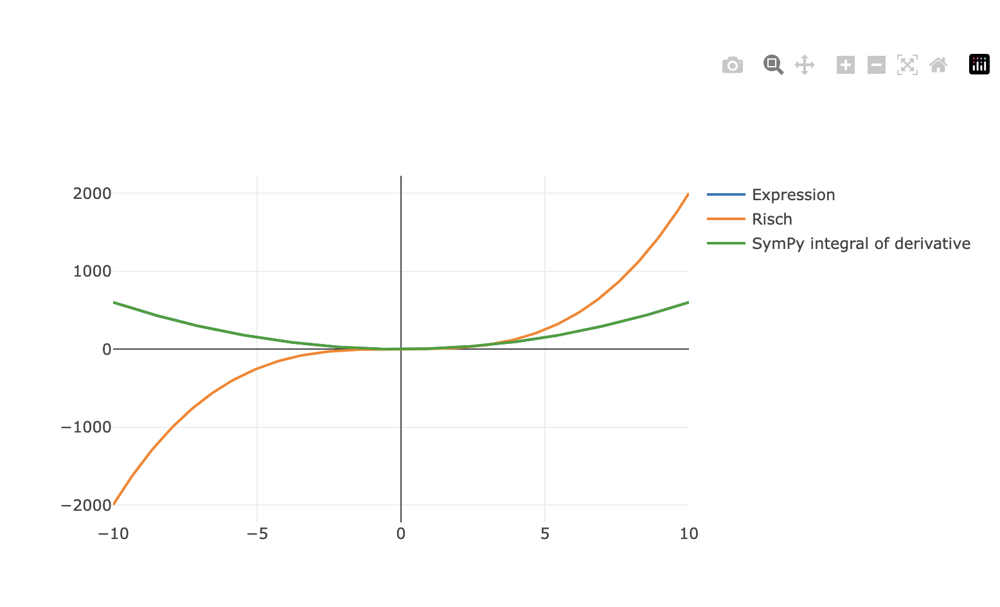

Generates random integrals. It generates a random function, finds derivative; uses symbolic computation algorithms to find the antiderivative, thereafter compares it to the original function. 

It is a python file, but can be displayed on the web. Just run the server. I'm too lazy to fix half the code so if you want to get the results of the algorithms and such, you gotta run the server. 

Run the server by running the python server and opening http://127.0.0.1:8000 on your browser. 

Example:

The graph is also shown thus:

