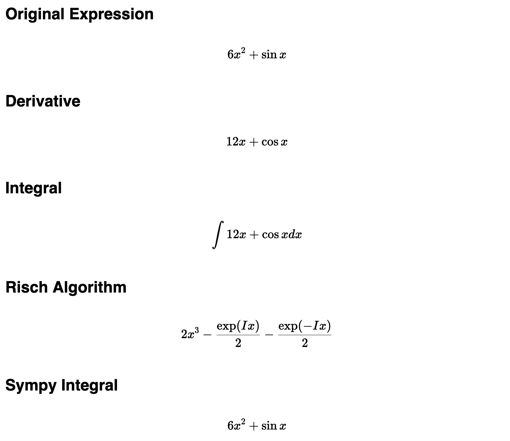

Generates random integrals. 

Is a python file, but can be displayed on the web. Just run the server. I'm too lazy to fix half the code so if you want to get the results of the algorithms and such, you gotta run the server. 

Run the server by running the python server and opening http://127.0.0.1:8000 on your browser. 

Example:

